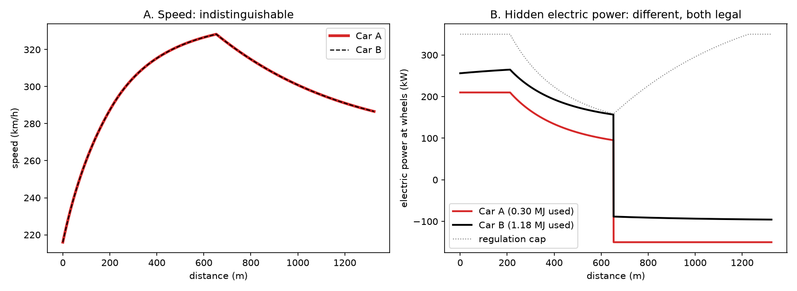
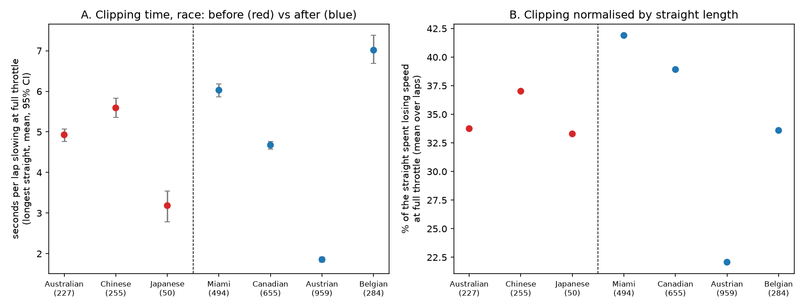
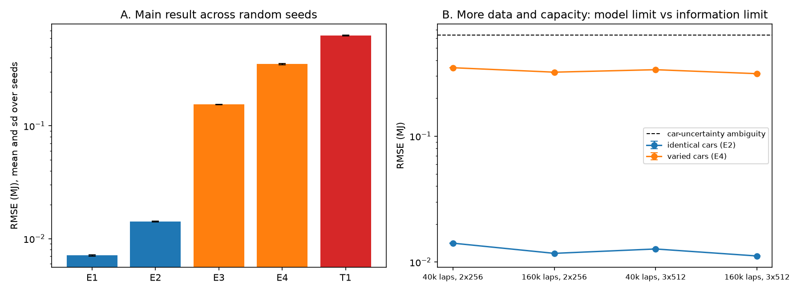
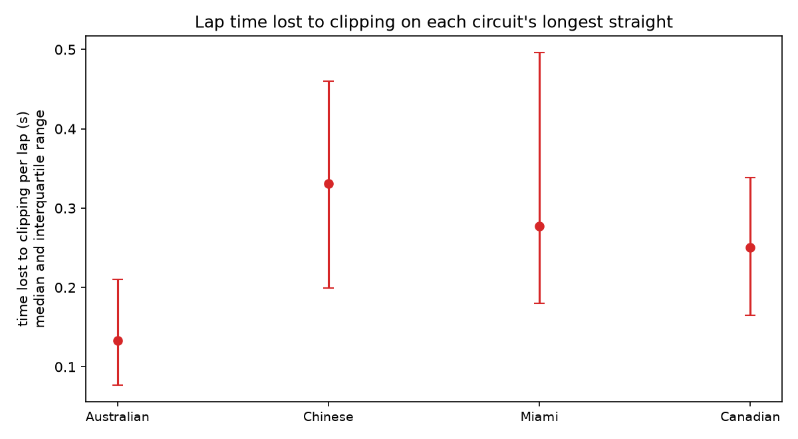
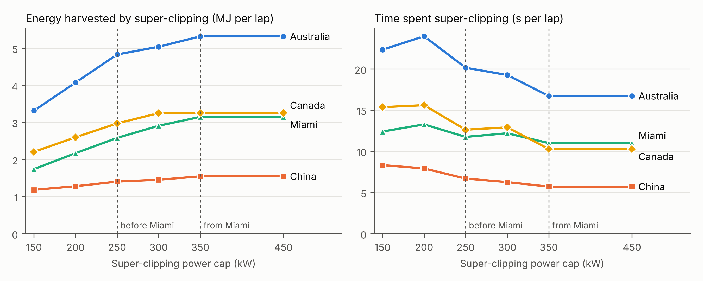

# ERS-Lens

**Live site: [priyanshi507.github.io/ers-lens](https://priyanshi507.github.io/ers-lens/)**, how much lap time each 2026 F1 car lost to clipping, race by race and lap by lap.

**What public telemetry can and cannot reveal about 2026 Formula 1 energy management.**

The 2026 regulations split power roughly equally between a ~400 kW combustion engine and a
350 kW electric motor (MGU-K), so battery deployment decides races. But battery charge,
deployment and harvesting are absent from the public timing feed
([FastF1 discussion #861](https://github.com/theOehrly/Fast-F1/discussions/861)).
ERS-Lens works out what an outsider can still learn from speed, throttle and brake data,
and measures it across the 2026 season.

> Status: active research. Every hypothesis is recorded in
> [`docs/research_log.md`](docs/research_log.md), including the ones that failed.

## Key findings

### 1. A car's battery state cannot be recovered from speed telemetry

On a full-throttle straight, a car with different engine power, different drag and a
different electric deployment can produce exactly the same speed trace. Electric power is identifiable
from speed only up to an unknown function of speed, so battery energy is not identifiable.



Searching a grid of engine power and drag values for regulation-legal alternatives
(deployment within the speed-dependent MGU-K cap at every instant) with identical
telemetry, battery energy used on one straight spans:

| ICE power known to within | Drag area known to within | Battery energy spread | Share of 4 MJ window |
| --- | --- | --- | --- |
| ±10% | ±20% | 2.53 MJ | 63% |
| ±5% | ±10% | 1.65 MJ | 41% |
| ±2% | ±5% | 0.76 MJ | 19% |

Reproduce: `python scripts/identifiability_demo.py`

### 2. The drop in electric power during clipping *can* be measured

On a clipping lap the car passes each speed twice at full throttle: accelerating before the
speed peak and decelerating after it. At equal speed, drag, rolling resistance and engine
power cancel, leaving only the change in electric power:

```
ΔP_e = (ΔKE + m·g·Δz_up) / T_up + (ΔKE − m·g·Δz_down) / T_down,   ΔKE = ½·m·(v_hi² − v_lo²)
```

It needs only the car's mass and the circuit's elevation profile, never drag or engine
power, so it returns the same answer for every car in finding 1. On 40 simulated cars
with 4 Hz sampling, whole-km/h rounding and noise: correlation **0.992** with the true
power drop, mean error **19.5 kW** on a 328 kW mean, no false detections.

### 3. Clipping is common on long straights, not on every circuit

| Race (2026) | Period | Clean laps | Laps clipping ≥3 km/h | Clipping time | Median power drop |
| --- | --- | --- | --- | --- | --- |
| Australia | before | 227 | 97% | 4.9 s | 187 kW |
| China | before | 255 | 93% | 5.6 s | 179 kW |
| Japan | before | 50 | 86% | 3.2 s | 185 kW |
| Miami | after | 494 | 96% | 6.0 s | 177 kW |
| Canada | after | 655 | 98% | 4.7 s | 206 kW |
| Austria | after | 959 | 82% | 1.9 s | 279 kW |
| Belgium | after | 284 | 96% | 7.0 s | 125 kW |

Measured on each circuit's longest interior straight. Normalised by straight length, cars
spent 34.7% of the straight losing speed at full throttle before the FIA's Miami changes and
34.1% after (exact permutation test with races as the unit, p = 0.51).



**Out-of-sample test: the seven-race result does not hold across the calendar.** Why those
seven races were chosen was never recorded, so the finding was re-tested on the 11 other 2026
races held so far, with predictions logged before any of their data was loaded (research log,
2026-10-30). Prediction E1 (at least 80% of clean laps clip at every new race) **failed**: it
held at 2 of 8 measurable races.

| Race (2026) | Measured straight | Clean laps | Laps clipping ≥3 km/h | Clipping time |
| --- | --- | --- | --- | --- |
| United States | 975 m | 700 | 93% | 3.5 s |
| Spain (Madrid) | 865 m | 636 | 92% | 1.9 s |
| Italy | 1240 m | 539 | 54% | 0.8 s |
| Bahrain | 700 m | 510 | 23% | 0.5 s |
| Barcelona | 415 m | 633 | 5% | 0.0 s |
| Monaco | 510 m | 960 | 4% | 0.0 s |
| Azerbaijan | 680 m | 582 | 1% | 0.0 s |
| Singapore | 590 m | 271 | 0% | 0.0 s |

Britain (18), the Netherlands (4) and Hungary (0 clean laps) had too few laps to measure.
The before/after comparison with all races (E2) is still not significant (p = 0.12), but it
is no longer informative: every race with almost no clipping comes after Miami, so circuit
and rule period cannot be separated. Clipping rises with the length
of the measured straight (Spearman 0.84 over 14 races).

**Whole straights: part of that failure was the measurement.** The method skipped any straight
crossing the start/finish line, because lap distance resets there. Re-cutting every lap at the
middle of the slowest corner measures those straights whole (`multi_race.py --rebase`), with
predictions logged first (research log, 2026-11-01):

| Race (2026) | Straight measured before / now | Laps clipping ≥3 km/h before / now |
| --- | --- | --- |
| Azerbaijan | 680 / 1,980 m | 1% / 97% |
| Japan | 730 / 2,030 m | 85% / 96% |
| Barcelona | 415 / 1,005 m | 5% / 39% |

Every straight that grew by 200 m or more shows more clipping (R1 held, 3 of 3), and straight
length still explains clipping (Spearman 0.80 over 16 races, R3 held). But most of the other
new races still clip on fewer than 80% of laps (R2 failed, 3 of 10): Monaco, Singapore and
Hungary show almost none on straights measured whole. Clipping is real wherever a straight is
long, and genuinely rare where none is.

### 4. Most 2026 public telemetry needs cleaning first

Physical plausibility checks (sample gaps, frozen or stale speed, braking into the corner,
flat-out run length) kept **2,924 of 6,400** candidate race laps. Without them, Shanghai
data suggested Gasly clipped on 24% of laps against 94% for teammate Colapinto in the same
car; after cleaning, the difference disappeared. It came from corrupted telemetry.

### 5. Neural networks trained in simulation can be confidently wrong

The identifiability result predicts a failure mode for machine learning: a network trained
on simulated laps where every car is identical can learn battery energy through the
simulator's fixed car parameters, not the physics. Predictions were committed to the
research log before any training run. Results are means over 5 random seeds.



| Training and test data | RMSE (MJ) | 90% intervals containing the truth |
| --- | --- | --- |
| Identical cars | 0.007–0.014 | 88–89% |
| Varied cars (ICE ±10%, drag ±20%) | 0.155–0.352 | 87–90% |
| **Trained on identical cars, tested on varied cars** | **0.633 ± 0.005** | **3%** |

Trained on identical cars, the network claims ±0.014 MJ certainty while its real error is
0.633 MJ: about 45 times overconfident, in every seed. Trained across realistic car
variation, it reports honest uncertainty instead (about ±0.30 MJ predicted against
0.35 MJ actual error). With 4× more data and a larger network, varied-car error falls only
10% (0.349 → 0.313 MJ) and stays 28 times the identical-car error; the network resolves
about half of the car-parameter ambiguity at every scale. Near-perfect accuracy on
simulated races is therefore weak evidence for real-race performance unless the simulator
varies the car.

Of nine pre-registered predictions, two did not hold: restricting strategies to a simple
family did not make battery energy learnable, and identical-car error fell 21% with more
data and capacity, not the predicted 30%. A training bug that silently returned untrained
weights after divergence was found from one anomalous error bar, fixed, and every
experiment re-run; details in the research log.
Reproduce: `python scripts/ml_identifiability.py` and `python scripts/ml_robustness.py`

### 6. Lap time lost to clipping

For strategists, the useful unit is seconds. For each lap, ERS-Lens simulates the same car
keeping its pre-clip power until the braking point, across every plausible combination of
engine power, drag and mass that fits the observed acceleration, and reports the time
difference.



| Circuit (2026) | Median time lost per lap | Interquartile range |
| --- | --- | --- |
| Australia | 0.13 s | 0.08–0.21 s |
| China | 0.33 s | 0.20–0.46 s |
| Miami | 0.28 s | 0.18–0.50 s |
| Canada | 0.25 s | 0.17–0.34 s |

Accuracy is about ±0.06 s per lap, measured on simulated laps that deliberately break the
method's assumptions (constant pre-clip power, gradual clipping, uphill road); the method
tends to overestimate when its deployment-shape assumption is wrong. On real laps, time
lost tracks the detector's clipping duration (Spearman 0.77–0.88 at three circuits, 0.54
in Australia). The method refuses to report circuits it cannot measure honestly: Austria
(only 30% of laps have enough running before the speed peak), Spa (61% of laps
physically implausible) and Japan (too few laps). Team comparisons are exploratory and not
claimed.

Out of sample (prediction E3, logged before the data was loaded), the 0.05–0.50 s range
**failed**: of the seven new circuits that pass the reporting rule, only the United States
(0.06 s) is inside it; Spain is 0.04 s and Monaco, Barcelona, Azerbaijan, Bahrain and Singapore
0.00 s. Italy is not reported (24% of laps physically implausible). Time lost to clipping is
material only where the measured straight is long.
Reproduce: `python scripts/laptime_real.py --events Australia China Japan Miami Canada Austria Belgium`

### 7. Hypotheses tested

Of the twelve hypotheses below, only one held as first tested, and it is not informative.
All were stated before their tests; ten were also recorded in the research log beforehand.

| Hypothesis | Result |
| --- | --- |
| Clipping share falls after the Miami changes | Not supported (34.7% vs 34.1%, p = 0.51) |
| Harvest power after clipping rises after Miami | Not supported |
| Elevation correction moves Austria and Spa towards flat circuits | Not supported |
| Deployment before clipping rose after Miami (held-out test: every later race ≥ 0.45) | Not confirmed (Italy 0.40) |
| Ramp-limited clipping fits better on ≥5 of 7 circuits | Not supported (1 of 7) |
| Regulation taper formula improves agreement between estimators | Not supported (0.55 → 0.54) |
| Median time lost per lap at every measurable circuit is 0.05–0.50 s | Not held on first run (Austria, Spa failed); after fixes, met at the four reported circuits |
| Time lost tracks the electric power drop (Spearman ≥ 0.4) | Not held (0.30); the check ignored clipping duration, against which Spearman is 0.54–0.88 |
| Parameter ambiguity in time lost is under 10% | Not held (about 17%) |
| E1: at least 80% of clean laps clip at every new race (11 races, out of sample) | Not held (2 of 8 measurable races) |
| E2: still no before/after Miami difference with all races | Held (p = 0.12), but confounded by circuit |
| E3: median time lost 0.05–0.50 s at every new reported circuit | Not held (1 of 7) |

### 8. Strategy Lab: the lap-time-optimal strategy clips

What is the fastest way to spend and recover electric energy on a 2026 lap, and does it clip?
Dynamic programming over battery state of charge finds the optimum for one charge-neutral lap
under the 2026 energy rules (MGU-K cap and speed taper, 4 MJ window, per-lap recharge limit).
Every result is checked: the optimizer's predicted lap time must match a replay in the lap
simulator to within 0.05 s, and the lap must end with the charge it started with, or the result
is not used. Seven predictions were recorded on
2026-10-05, before any code.

The model car could not be calibrated to one drag and engine-power value: the four pole laps
prefer different points on a ridge of equally good fits. So every prediction was tested on
three cars (the original car and both ends of that ridge), and a verdict counts only if it is
the same for all three.

| Prediction | Result on the three cars |
| --- | --- |
| S1: the optimum clips on the longest straight (power at the speed peak ≤ 50% of its earlier mean) | **Held** on all three with the car-file limit; with the per-race 2026 limits on two of three (high-drag end, Australia 0.70) |
| S3: it still clips with the MGU-K speed taper removed, at ≥ 3 of 4 circuits | Held on two of three with the car-file limit (original car 2 of 4: Australia and Miami 0.51, against 0.50); with the per-race limits on one of three |
| S2: the optimum clips for ≥ 80% of 27 legal cars at every circuit | Depends on the car: holds for the original car, fails at both ends of the ridge (low-drag China 78%, high-drag Australia 70%) |
| S4: energy is deployed ≥ 20 km/h below the mean full-throttle speed | Depends on the car: 16-24 km/h at the high-drag end |
| S5: the optimum is within 0.3 s of the best tuned simple rule | **Not held**: the optimum is 1.8-3.7 s faster |
| S6: gradient descent through the JAX simulator matches the DP optimum | **Not held**: it stalls in local optima |
| S7: the optimal speed-peak position lies in the range seen on real laps | **Not held** (0 of 4 circuits, every car) |

These are the results of the corrected solver and harvest limit (2026-11-13; results/strategy_*_h).
The harvest-limit correction changed no verdict here. Against the
first runs, the solver fix changed four verdicts: S3 for the original car (both limits) and S1 under the
per-race limits for the high-drag end from held to not held, and S2 for the low-drag end from
held to not held. Several clip ratios sit close to the 0.50 threshold, so S1 and S3 are fragile:
a small change of car or rules moves them.

The optimum clips at the end of the longest straight on every car with the car-file limit, and
with the taper removed it still clips on two of the three cars: near top speed, drag absorbs
power roughly as v³, so a joule deployed there buys little time. Clipping is therefore partly
the optimizer's choice and not only a side effect of the taper, but that conclusion holds for
some cars and limits, not all. The optimum is bang-bang on every car (95-99% of full-throttle
points of the nominal laps at the MGU-K cap or at zero). Compared with real race laps, lined up at the braking point,
the original car's optimum peaks too late at every circuit, while each calibrated car lands
inside the middle half of real laps at two of four circuits (exploratory: the battery is not
observable). The car calibration failed its own acceptance test, so modelled lap
times carry about ±0.7 s per lap of between-circuit uncertainty, and the pole laps are assumed
to be close to energy-optimal.
Explore every optimal lap on the [Strategy Lab page](https://priyanshi507.github.io/ers-lens/strategy.html).
Full record: [`docs/research_log.md`](docs/research_log.md), entries from 2026-10-05.
Reproduce: `scripts/kaggle_rerun_strategy.md` (free Kaggle T4 x2), or `python scripts/strategy_run.py --tracks
results/tracks --car configs/car_2026_q_low.yaml --out results/strategy_q_low_h`, then `--rules` and
`--refine`, then `python scripts/strategy_evaluate.py --runs results/strategy_q_low_h/runs.csv`

### 9. The FIA's Miami fix, solved on the same circuits

From Miami the FIA raised the power a car may harvest while flat out (super-clipping) from
250 to 350 kW. Real races cannot show the effect: each circuit raced under one rule, and every
circuit with almost no clipping came after Miami. So the Strategy Lab solves each circuit under
both caps with everything else equal. Predictions were recorded before each run (research log,
2026-11-01).

| Result under 350 kW, original car, 18 circuits | Circuits |
| --- | --- |
| Super-clipping harvests more energy (C1) | **15 of 18, held** (not Bahrain or Spain; Monaco: none under either cap) |
| Less of it on the longest straight (not predicted) | 13 of 18 (not China, the Netherlands or Spain; Monaco and Singapore: none there) |
| More of it below 250 km/h (not predicted) | 14 of 18 (not Bahrain, Monaco, Singapore, Spain) |
| More of it below 200 km/h (C2) | 13 of 18, **not held** (not Bahrain, Hungary, Monaco, Singapore, Spain) |
| Lap never slower by more than 0.02 s (C3) | **18 of 18, held** (Bahrain 0.020 s slower, see below) |

In the model, the fix does what it aimed at on the straights at most circuits, less super-clipping
at the end of the longest one, while super-clipping as a whole takes more energy, mostly at lower
speeds. On four circuits with three cars, total super-clipping time fell at all 12 pairs while its
energy rose by 3.5-22% (predictions F1-F4: F2, F3 and F4 held; F1 not held, because the lap gain
exceeded the predicted 0.20 s for two cars at Australia). This is the lap-time optimum of a
simplified car, not a measurement of real cars. Every circuit uses its recharge limit from the
FIA's per-race Power Unit Information document
([`configs/rules_2026_races.yaml`](configs/rules_2026_races.yaml)).

These results use the corrected solver and the corrected harvest limit (results/fia_fix_calendar_h
and results/fia_fix_h, 2026-11-13). The harvest correction: the model had applied the MGU-K's
speed taper, which the rules apply only to propulsion (C5.2.8), to harvesting as well; it now
limits harvesting by the absolute 350 kW (C5.2.7). Against the tapered runs it changed no verdict,
but it moved the counts (C1 17 to 15, C2 14 to 13, less on the longest straight 16 to 13), so the
earlier explanation of this finding, which relied on the taper, has been withdrawn. Bahrain is
the one circuit where 350 kW gives a slower lap than 250 kW (by 0.020 s); that solve leaves
0.16 MJ of its recharge limit unused because the solver's harvest-price search was coarse; with
a finer search 350 kW is faster there too (92.528 against 92.531 s), and the re-run of this
finding with it is pending (research log, 2026-11-13). The first runs, kept unchanged, recorded
C1 held (16), C2 not held (12), C3 not held (17), F2 not held (8 of 12) and F3 held (10 of 12);
the failures there came from solves that the solver bug broke (research log, 2026-11-03).



Explore every circuit under both caps on the [FIA-fix page](https://priyanshi507.github.io/ers-lens/fia.html).

Reproduce: `scripts/kaggle_rerun_harvest.md` (free Kaggle T4 x2), or `python scripts/fia_fix.py --out
results/fia_fix_h` (four circuits) and `--cars original --caps 250 350 --out
results/fia_fix_calendar_h --events ...` (every circuit), then `python scripts/fia_fix_verdicts.py
[--calendar] --runs <out>/runs.csv`.

### 10. Whole-race energy plans: carry a little more charge, spend it at the end

Which charge should a car carry from lap to lap over a race? A lap table (fastest lap from every
start charge to every end charge, 0-4 MJ in 0.5 MJ steps, within the recharge limit, every lap a
simulator replay) feeds a race-level plan. Prior work on race allocation for the 2014-2025 power
unit: Duhr et al., *IEEE Transactions on Vehicular Technology* 72(6), 2023. Before the plans are
judged, every same-charge lap in the table must be within 0.05 s of an independent single-lap
solve; this failed twice (price search too coarse, research log 2026-11-02 and 2026-11-13) and
passes on the corrected tables (largest difference 0.006 s).

| Prediction (2026-11-02), original car, 4 circuits | Result |
| --- | --- |
| W1: the best plan is within 0.1 s of a simple plan (hold 2 MJ, spend on the last lap) | **Not held**, 2 of 4 (Australia 0.45 s, Canada 1.42 s better) |
| W2: the best plan gains 0.1-1.0 s over holding 2 MJ all race | **Not held**, 3 of 4 (Canada 1.88 s) |
| W3: the best plan ends the race at 0 MJ | **Not held**, 3 of 4 (Miami ends at 0.5 MJ) |

Found afterwards: a charge-neutral lap is fastest on a plateau from about 2.5 to 3.5 MJ and slower
at both ends (too little charge runs the battery short within the lap; a full battery leaves no
room to harvest). At Australia and Canada 2 MJ is below the plateau, so the best plan builds
0.5 MJ on lap 1, holds it and spends it on the last lap; at China and Miami 2 MJ is already on it.
The per-lap differences are small (0.008 s at Australia, 0.023 s at Canada) and are confirmed by
single-lap solves whose proven optimality gap is at most 0.003 s; over 58-68 laps they add up.
results/race_h2; research log, 2026-11-13.

### 11. The FIA's real 250 kW sectors

From Miami, in race sectors that each event's FIA document names, MGU-K deployment is limited to
250 kW below 310 km/h (Section C, Issue 21, C5.2.8 iii; Section B, Issue 09, B7.2.1 b xii). The
Strategy Lab now applies each race's own sectors (14 circuits, read from the FIA PDFs;
[`configs/deploy_sectors_2026.yaml`](configs/deploy_sectors_2026.yaml)) and compares them with no
sector limit and with 250 kW on the whole lap, the bound used before.

| Original car, 14 circuits | Result |
| --- | --- |
| P1: no limit <= FIA sectors <= 250 kW everywhere | **14 of 14, held** |
| P2: the sectors cost at most half of 250 kW everywhere | **14 of 14, held** |
| P3: the optimum deploys less inside the sectors and more outside | **14 of 14, held** |

The real sectors cost 0.028-0.226 s per lap (Britain and Italy least, Spain most, where they
cover 66% of the lap), against 0.27-0.57 s for 250 kW everywhere: summed over the 14 circuits, the
old bound overstated the rule's cost 5.5 times. The rule applies "during any power limited period", defined in an FIA document
that is not public, so these numbers are the most the sectors can cost; the true cost lies
between zero and them. Predictions were written before the run (research log, 2026-11-03). The
first run, with the solver bug, recorded P1-P3 not held; its two impossible laps (an extra
limit giving a faster lap) are what exposed the bug. These numbers use the corrected solver and
harvest limit (results/sectors_h, 2026-11-13); the harvest correction changed P3 from 13 to 14
of 14 and no other verdict.

### Performance: the solver on a free GPU

Every speed-up below gives the same lap times as before (bit-for-bit for the last two rows),
measured on Kaggle's free Tesla T4 with predictions written before each run.

| Step (Australia, fine grid) | One backward pass | Full solve |
| --- | --- | --- |
| XLA, first layout | 12.57 s | 96.8 s |
| XLA, charge-last array layout | 7.05-7.50 s | 58 s |
| Hand-written CUDA kernel (`src/erslens/cuda_dp.py`) | 3.79 s | 30.6 s |

The kernel gives each (speed, charge) state one GPU thread that loops over the power commands,
so the physics step, the value-table lookup and the minimum run fused in registers. Its source
is also compiled as C++ and checked against a NumPy twin in the tests, so it is verified without
a GPU. It met its accuracy and full-solve predictions but not the 2x backward-pass prediction
(1.86-1.96x). Use it with `ERSLENS_DP_BACKEND=cuda` on any CUDA GPU; reproduce the comparison
with `scripts/kaggle_cuda_benchmark.md`.

## Repository

```
configs/car_2026.yaml       car and regulation parameters (sources noted per value)
configs/rules_2026_races.yaml  per-race and qualifying recharge limits (sources noted)
configs/car_2026_q_*.yaml   the two ends of the calibration ridge (finding 8)
src/erslens/
    physics.py              forces, braking envelope, MGU-K speed taper (single shared implementation)
    simulate.py             lap simulator with 2026 energy rules (NumPy)
    jaxsim.py               differentiable simulator in JAX, verified against simulate.py
    energy.py               matched-speed estimator with elevation correction
    straightfit.py          3-parameter clipping fit (step and ramp models)
    laptime.py              time lost to clipping, with bounds over car parameters
    throttle.py             one shared definition of full-throttle running
    synthstraight.py        simulated straights for the ML experiment (JAX)
    gaussnet.py             neural network with calibrated Gaussian uncertainty (JAX, Optax)
    ingest.py               FastF1 loading, track and elevation profiles
    optimal.py              Strategy Lab method M1: dynamic programming over state of charge
    cuda_dp.py              the DP backward pass as one hand-written CUDA kernel (CuPy)
    gradopt.py              Strategy Lab method M2: gradient descent through the JAX simulator
    simple.py               simple deployment rules, tuned by exhaustive search
    strategy.py             S1-S7 measurements, legal-car sweep, per-race rules, convergence rule
    race.py                 finding 10: lap tables over charge levels and the race-level plan
    sectors.py              the FIA's per-race 250 kW deployment sectors on a track
    params.py, track.py, policies.py, synth.py   car parameters, track geometry, deployment rules, synthetic data
    openf1.py               OpenF1 and Jolpica clients (cached), the free source since F1's archive closed
scripts/
    derate_analysis.py      quality checks and full-throttle speed-loss detection
    multi_race.py           clipping across races, before/after comparison
    energy_real.py          matched-speed estimates on real races
    straight_real.py        parametric fits, model comparison, sensitivity
    energy_validate.py      estimator validation against simulated ground truth
    identifiability_demo.py finding 1
    ml_identifiability.py   finding 5
    ml_robustness.py        finding 5: seeds and capacity/data control
    laptime_real.py         finding 6 on real races
    laptime_stress.py       finding 6: accuracy when the method's assumptions are broken
    calibrate_car.py        finding 8: fit drag and engine power to pole laps
    strategy_run.py         finding 8: all Strategy Lab stages
    strategy_evaluate.py    finding 8: verdicts S1-S7
    fia_fix.py              finding 9: every circuit under the 250 and 350 kW caps
    fia_fix_verdicts.py     finding 9: verdicts F1-F4 and C1-C3
    fia_fix_figures.py      finding 9 figures
    rebase_compare.py       finding 3: straights measured whole across the start/finish line
    race_plan.py            finding 10: lap tables (GPU) and race plans
    sectors_run.py          finding 11: the 250 kW sectors against none and everywhere (P1-P3)
    gpu_benchmark.py        the solver on CPU and GPU, results checked for equality
    step_cost.py            operation and memory counts of one DP step (XLA cost analysis)
    cuda_benchmark.py       the CUDA kernel against XLA, results checked for equality
    export_site.py, export_strategy.py, export_fia.py, export_tracks.py   data for the site and for GPU runs
    kaggle_*.md             step-by-step runs on Kaggle's free T4
    (others)                diagnostics and checks referenced from the research log
tests/                      159 automated tests (physics invariants, estimators, optimizers, verdict logic)
site/                       the Explorer, Strategy Lab and FIA-fix pages (GitHub Pages)
docs/research_log.md        dated log of every decision, prediction and result
results/                    per-lap and per-race outputs
```

## Reproduce

```bash
python3.12 -m venv .venv && source .venv/bin/activate
pip install -r requirements-lock.txt
pip install -e . --no-deps
python -m pytest

python scripts/identifiability_demo.py
python scripts/ml_identifiability.py
python scripts/ml_robustness.py
python scripts/laptime_stress.py
python scripts/energy_validate.py
python scripts/multi_race.py --session R --events Australia China Japan Miami Canada Austria Belgium
python scripts/energy_real.py --events Australia China Japan Miami Canada Austria Belgium
python scripts/straight_real.py --events Australia China Japan Miami Canada Austria Belgium
python scripts/laptime_real.py --events Australia China Japan Miami Canada Austria Belgium
```

Raw telemetry is Formula 1 timing data downloaded through [FastF1](https://github.com/theOehrly/Fast-F1)
and is not redistributed here. Since mid-October 2026 F1's timing archive requires an F1 TV
subscription ([FastF1 #978](https://github.com/theOehrly/Fast-F1/issues/978)), so races not
already cached are read from [OpenF1](https://openf1.org/)'s free recording of the same feed:
set `ERSLENS_SOURCE=openf1`. On six races both sources hold, the two agree on every check
(`python scripts/compare_sources.py`, research log 2026-10-30).

## Limitations

- Harvest limit correction, 2026-11-04: the model applied the MGU-K speed taper to harvesting as
  well as deployment, but the FIA's taper (C5.2.8) limits only power used to propel the car;
  harvesting is limited by the absolute 350 kW (C5.2.7). Fixed, and findings 8, 9 and 11 are
  re-run with it (2026-11-13): no verdict changed except P3 (13 to 14 of 14). The prediction that
  no solve would get slower by more than 0.02 s failed once (Bahrain, +0.026 s), traced to the
  solver's coarse harvest-price search; ten bisection steps fix it (0.003 s gap, research log 2026-11-13).
- Solver resolution: lap times are trusted to 0.05 s (the convergence rule). Since 2026-11-13 each
  solve also carries a proven optimality gap (weak duality on the harvest price) on the DP's own
  model and grid. Findings 8, 9 and 11 were solved with a coarser price search (gaps up to 0.056 s
  at Bahrain) and are being re-run with the finer one; until then, differences under about 0.05 s
  between two of their solves, such as Bahrain's 0.020 s in finding 9, are not findings.
- Solver correction, 2026-11-03: where braking alone could recover more than the per-lap recharge
  limit, the DP could return a lap that ended below its starting charge (the price on harvest
  could not reach braking harvest). Fixed: braking harvest now follows the DP's command, the price
  search tests the planned harvest, and the convergence rule also requires the lap to keep its
  charge. Findings 8, 9 and 11 are re-run with the fixed solver; verdicts that changed are
  listed in each finding (research log, 2026-11-03 and 2026-11-04).
- The MGU-K taper formula (1800 − 5v kW below 340 km/h, 6900 − 20v kW from 340 to 345 km/h)
  is article C5.2.8 of the FIA 2026 F1 Regulations, Section C, Issue 21 (19 October 2026), as in
  the [2024 Issue 6](https://www.fia.com/sites/default/files/fia_2026_formula_1_technical_regulations_pu_-_issue_6_-_2024-03-29.pdf).
  The model's 50 kW/s ramp is the rule only at some races: C5.12.6 limits the reduction to 50 kW
  per second where the FIA's power-limited distance exceeds 3500 m and 100 kW elsewhere (each
  race's document states which). The data reject a ramp as a description of clipping either
  way, and the power-drop estimator depends on neither.
- Results cover full-throttle straights only; one straight per circuit. A straight that
  crosses the start/finish line is measured whole only with `--rebase` (finding 3); one that
  ends in a fast corner cannot be measured.
- Car mass is assumed (768 kg plus a nominal fuel load); a 5% error shifts power drops by ~5%.
- Slipstream and Override Mode are not yet separated from clipping.
- From Miami, C5.2.8 iii limits deployment during power-limited periods to 250 kW below 310 km/h
  (then the usual taper) in race sectors that each race's FIA document names (Section B, Issue 09,
  B7.2.1 b xii). The model uses one taper everywhere, with 250 kW everywhere as an extreme-case
  bound; modelling the named sectors is the next step.
- Time lost assumes pre-clip deployment is a fixed fraction of the regulation limit; when it
  is not, the estimate is biased high by up to about 0.06 s per lap. It needs about 4 s of
  full-throttle running before the speed peak, so short straights cannot be measured.
- Real battery data are not public, so validation relies on simulation and agreement between
  two estimators.

## Related work

The closest work is [Kleisarchaki (2026)](https://arxiv.org/abs/2603.01290), an HMM–POMDP
framework for inferring rival ERS state from telemetry, evaluated on synthetic races.
Optimal ERS control for known cars goes back to Limebeer, Perantoni and Rao (2014,
*International Journal of Control*); minimum-lap-time and race-level energy allocation for the
2014-2025 power unit were developed at ETH Zurich (Duhr, Buccheri, Balerna, Cerofolini and
Onder, *IEEE Transactions on Vehicular Technology* 72(6), 2023, and earlier papers). ERS-Lens is the empirical, observation-side complement:
what an outsider can verify from public data.

## Licence

MIT. Independent work, not affiliated with Formula 1, the FIA or any team.
Contact: Priyanshi Sharma, [github.com/Priyanshi507](https://github.com/Priyanshi507).
